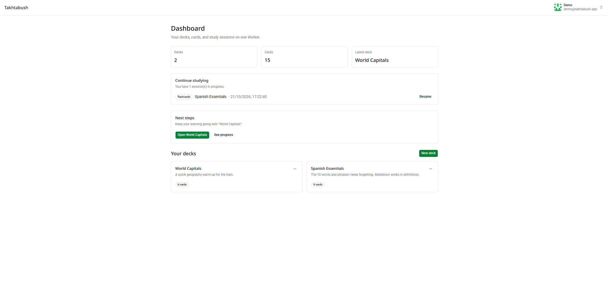
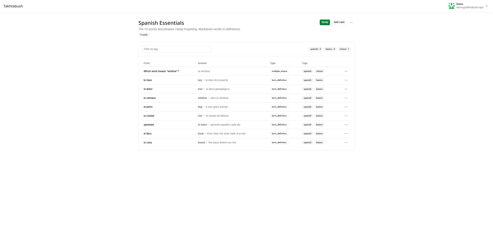
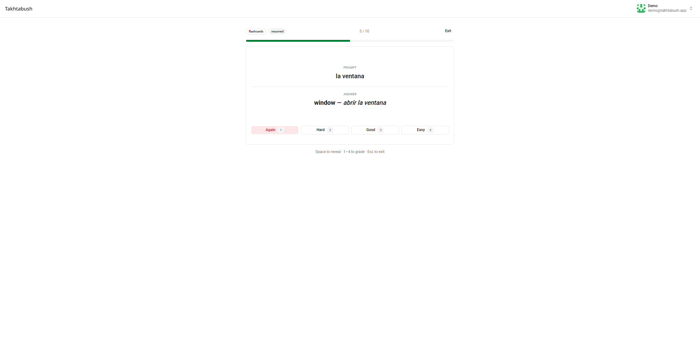
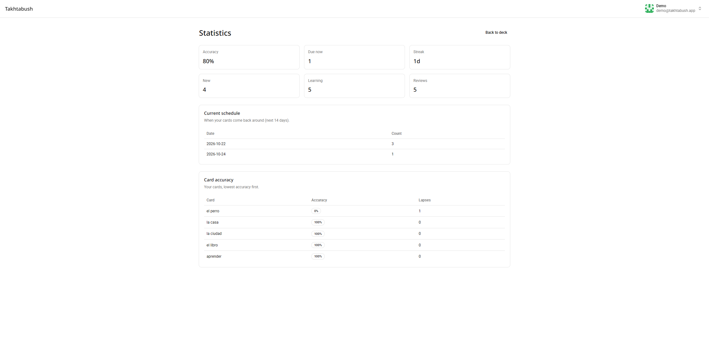

# Takhtabush documentation

Takhtabush is a self-hosted flashcard app that ships as **one Cloudflare
Worker**. It gives you decks, cards, six study modes, a versioned scheduler, an
authenticated media proxy, and an MCP endpoint for coding agents.

## Two ways in

| I want to…                                                                           | Start here                             |
| ------------------------------------------------------------------------------------ | -------------------------------------- |
| **Study.** Sign in, build or import decks, and use the study modes.                  | [User guide](user/README.md)           |
| **Build.** Self-host it, understand the architecture, connect agents, or contribute. | [Developer guide](developer/README.md) |

## The short version

- **For learners:** decks and cards, six study modes, progress and weak cards,
  import/export, and an optional AI assistant connection.
- **For builders:** one Worker, D1 + R2, a deterministic scheduler, scoped MCP
  tools, a self-hosting checklist, and a generated HTTP/MCP reference.
- **For everyone:** single tenant by default, magic-link sign-in, Markdown
  definitions, light/dark themes, MIT license.

## Screenshots

| Deck                                      | Study                                          |
| ----------------------------------------- | ---------------------------------------------- |
|  |  |

## Project links

- [Source and issues](https://github.com/calycode/takhtabush)
- [Design specification](../SPEC.md)
- [Contributing](../CONTRIBUTING.md)
- [Security policy](../SECURITY.md)
- [License](../LICENSE)
